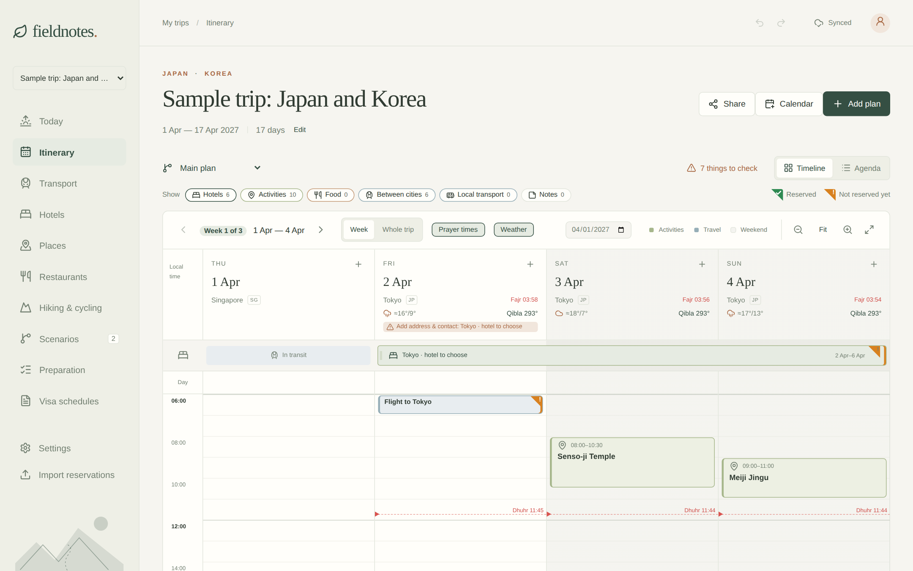
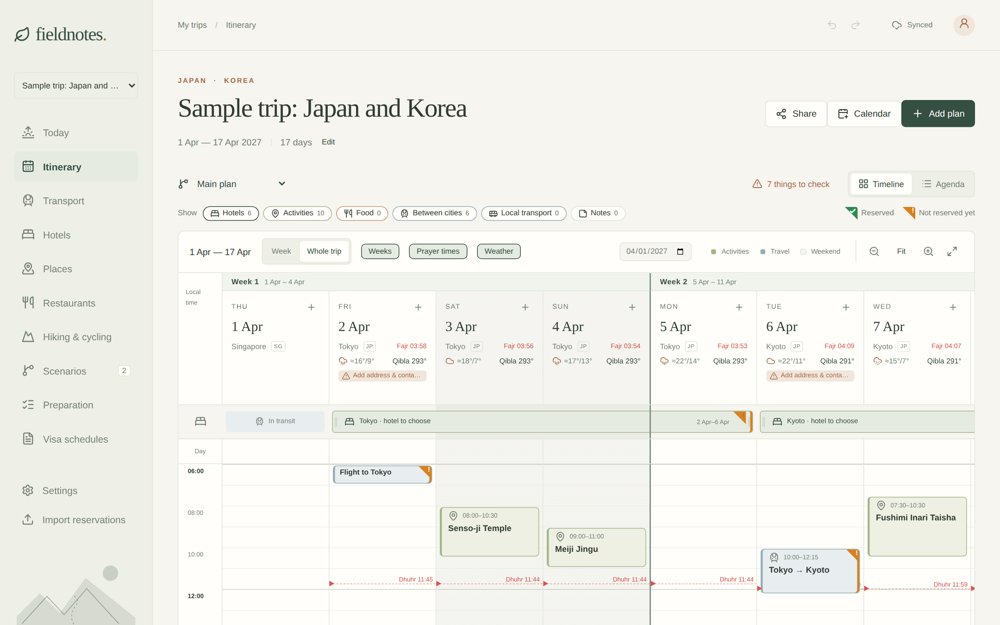
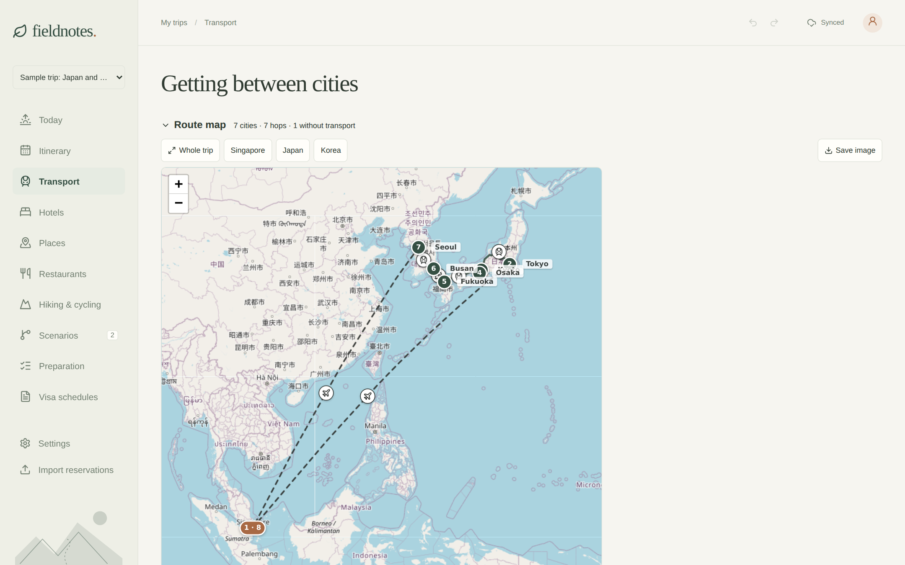
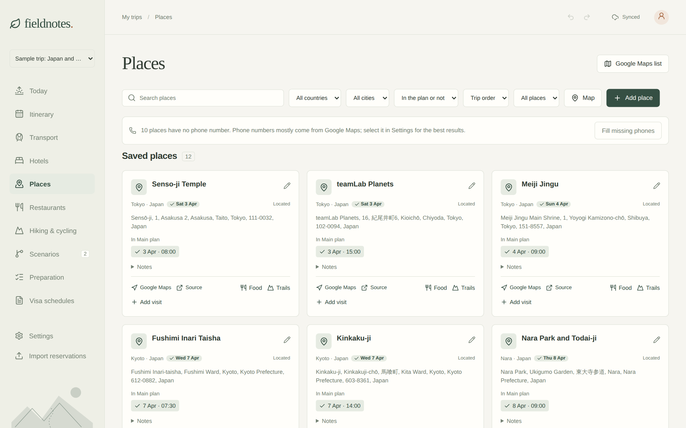
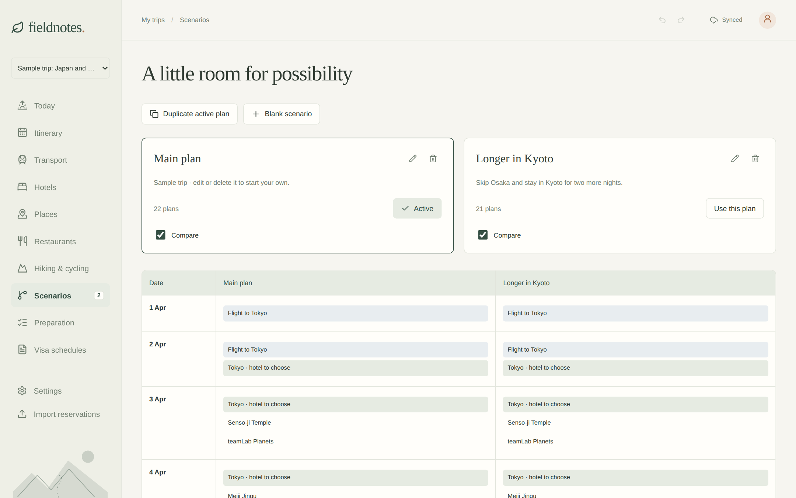
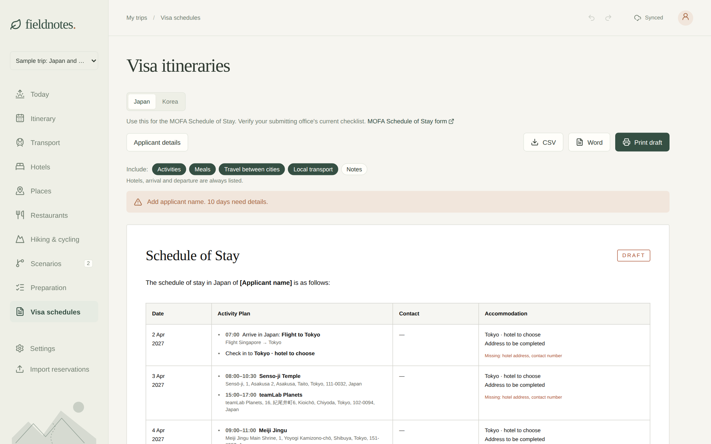
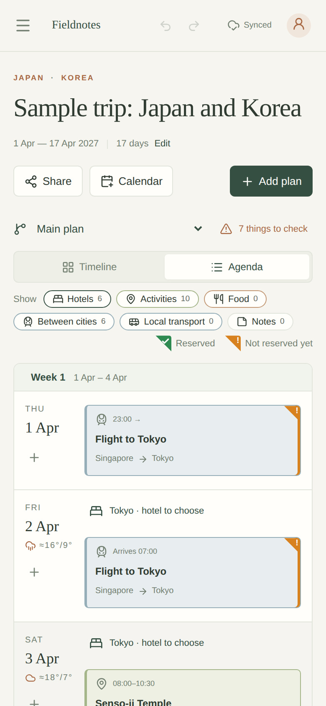

<div align="center">


# Fieldnotes

**A self-hosted, offline-first travel planner.**<br>
Plan the trip, keep the alternatives, and take it all with you offline.

[](https://github.com/KonyAHS/fieldnotes/stargazers)
[](https://hub.docker.com/r/konyoshino/fieldnotes)
[](https://hub.docker.com/r/konyoshino/fieldnotes/tags)
[](https://github.com/KonyAHS/fieldnotes/tags)
[](https://github.com/KonyAHS/fieldnotes/actions/workflows/ci.yml)
[](LICENSE)

[Quick start](#quick-start) · [Features](#features) · [Screenshots](#screenshots) · [Guide](docs/guide.md) · [Docker Hub](https://hub.docker.com/r/konyoshino/fieldnotes)



</div>

## Features

- 🗓️ **Timeline and agenda**: days across, hours down, with drag-and-drop, undo, weather and a list of things to check.
- 🔀 **Scenarios**: branch a trip into alternative plans and compare them side by side.
- 🚆 **Transport**: compare route options, see the whole trip on a map, and keep tickets in one place.
- 📍 **Places and restaurants**: search OpenStreetMap or Google Maps, find food nearby (with a halal-friendly filter), and hiking and cycling routes.
- 📴 **Works offline**: an installable app that keeps your plan and attachments on every device and syncs when back online.
- 📄 **Exports**: visa schedules (Japan, Korea, China), calendar feeds, share images and backups.
- 🤖 **AI-ready**: an MCP endpoint so assistants can read and edit the plan.

## Quick start

```bash
mkdir -p data && sudo chown 1000:1000 data
docker run -d --name fieldnotes -p 3000:3000 -v "$PWD/data:/data" \
  --restart unless-stopped konyoshino/fieldnotes:latest
```

Open **http://localhost:3000**. A small sample trip is there to explore; delete it when you start your own.

<details>
<summary><b>Docker Compose</b></summary>

<br>

Use the [`docker-compose.yml`](docker-compose.yml) in this repository:

```bash
mkdir -p data && sudo chown 1000:1000 data
docker compose up -d
```

Copy [`.env.example`](.env.example) to `.env` to change the image, port, data folder or time zone.

</details>

<details>
<summary><b>Configuration</b></summary>

<br>

| Variable   | Default   | Meaning                                  |
| ---------- | --------- | ---------------------------------------- |
| `PORT`     | `3000`    | Port the server listens on               |
| `HOST`     | `0.0.0.0` | Address the server binds to              |
| `DATA_DIR` | `/data`   | Database, attachments and secrets        |
| `TZ`       | `UTC`     | Server time zone (trips carry their own) |

Maps, mailbox import and appearance are set in the app under **Settings**.

</details>

<details>
<summary><b>Run from source</b></summary>

<br>

Requires Node 24 or newer.

```bash
npm ci
npm run server   # API on 127.0.0.1:3096
npm run dev      # app on 127.0.0.1:5173
npm test
```

</details>

> [!IMPORTANT]
> Fieldnotes has **no login**. Anyone who can reach it can see and edit your trips. Keep it on your home network or a VPN, or put it behind a proxy with authentication.
>
> Offline mode needs HTTPS (or `localhost`), for example through a reverse proxy or Tailscale Serve.

## Screenshots

<table>
  <tr>
    <td width="50%"><p align="center"><sub>Whole-trip timeline</sub></p></td>
    <td width="50%"><p align="center"><sub>Route map</sub></p></td>
  </tr>
  <tr>
    <td><p align="center"><sub>Places</sub></p></td>
    <td><p align="center"><sub>Scenarios</sub></p></td>
  </tr>
</table>

<details>
<summary><b>More screenshots</b></summary>

<br>

<table>
  <tr>
    <td width="68%"><p align="center"><sub>Visa schedule</sub></p></td>
    <td width="32%"><p align="center"><sub>On a phone</sub></p></td>
  </tr>
</table>

</details>

## Learn more

The **[guide](docs/guide.md)** covers every feature in detail: importing Booking.com and Airbnb reservations, offline sync, maps and halal information, the AI agent tools, and backups.

## Star history

<a href="https://star-history.com/#KonyAHS/fieldnotes&Date">
  <picture>
    <source media="(prefers-color-scheme: dark)" srcset="https://api.star-history.com/svg?repos=KonyAHS/fieldnotes&type=Date&theme=dark">
    
  </picture>
</a>

If Fieldnotes is useful to you, a ⭐ helps others find it.

## License

[ISC](LICENSE)
